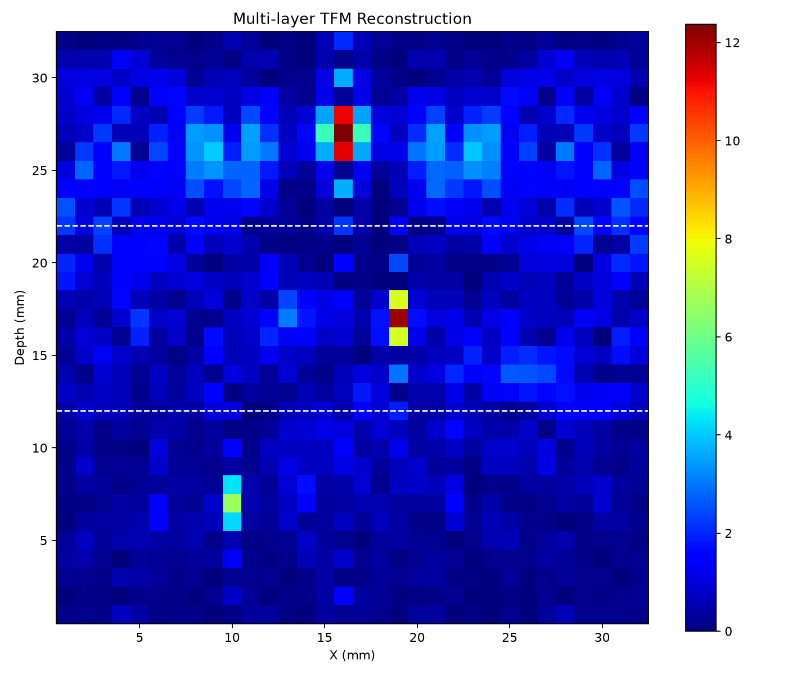

# Multi-layer FMC-TFM / 多层介质超声全聚焦成像

Python and Rust implementations reorganized from `TMF.m`, with a MATLAB reference and numerical checks.

从 `TMF.m` 整理、移植的三层介质超声 FMC-TFM 算法，提供 Python、Rust、MATLAB 参考代码和数值验证。

[中文说明](#中文说明) · [English guide](#english-guide) · [详细推导 / Algorithm details](docs/algorithm.md) · [验证记录 / Validation](validation/README.md)



Synthetic targets at (10,7), (19,17), (16,27) mm / 合成靶标坐标，虚线为界面。

## 中文说明

### 项目结构

```text
config/                   两种语言共用的 JSON 参数
python/tfm/
  config.py               参数及约束
  data.py                 TXT 读取、校验、峰值第一遍扫描
  travel.py               整数毫米走时表和阵元缓存
  reconstruction.py       校时、截断、插值、相干叠加和包络
  cli.py                  命令行、MAT/NPZ/CSV 导出、绘图
rust/src/
  config.rs, data.rs      参数与逐文件读取
  travel.rs               离散走时和传播缓存
  lib.rs                  可复用重建库及测试
  main.rs                 独立 Rust 命令行、CSV/JSON 导出
matlab/TMF_original.m     参考脚本，仅替换个人输入路径、统一换行
tools/                    合成数据、MATLAB 对照脚本生成、误差比较
tests/                    Python 数值与输入校验测试
validation/               验证过程及实际测得的误差
```

### 输入数据

一个文件夹内放置 `1.txt` 至 `N.txt`，每个文件对应一次发射，必须有 `N+1` 列。

| 列 | 内容 | 单位 |
|---|---|---|
| 第一列 | 所有文件一致的时间轴 | 秒 |
| 第 2 至 N+1 列 | N 个接收通道的有符号回波 | 保留原始幅值单位 |

支持空白字符、制表符或逗号分隔的数值，忽略空行以及以 `%`、`#` 开始的注释。其余文本表头会报错。输入文件夹只应包含这组编号 TXT；不要混放其他 TXT。

时间列转换成 float32 后必须严格递增，步长在计算所得 `dt` 的 1% 内；不同文件对应时间点的差不超过 `0.01*dt`。非均匀采样需要先重采样。

原脚本在循环里设置 `tx=j, rx=k`，虽然文件编号通常对应发射编号，但这里保留了原编号关系。当前传播时间和第一层权重对交换发射、接收对称，因此不改变结果。校时直接使用峰值的样本编号，不再减去时间列起点。

### 快速运行

Python 需要 3.10 或以上版本；Rust 使用稳定工具链及所在平台的链接器。下面命令在仓库根目录执行。

```bash
git clone https://github.com/chizhu2017/multilayer-fmc-tfm.git
cd multilayer-fmc-tfm
python -m venv .venv
```

激活环境：Windows PowerShell 用 `.\.venv\Scripts\Activate.ps1`；Linux/macOS 用 `source .venv/bin/activate`。如 PowerShell 禁止激活，可直接用 `.\.venv\Scripts\python.exe` 替代后续的 `python`。

```bash
python -m pip install -e ".[test]"
python tools/generate_demo.py data/demo
python -m tfm.cli data/demo --config config/demo.json --output results/demo-python
cargo run --release --locked --manifest-path rust/Cargo.toml -- data/demo --config config/demo.json --output results/demo-rust
python tools/compare.py results/demo-python results/demo-rust
```

处理实际数据：

```bash
python -m tfm.cli "YOUR_FMC_DIRECTORY" --config config/default.json --output results/python
cargo run --release --locked --manifest-path rust/Cargo.toml -- "YOUR_FMC_DIRECTORY" --config config/default.json --output results/rust
```

Windows GNU 工具链若无法链接中文路径，将编译产物放到英文目录后重试：`$env:CARGO_TARGET_DIR = 'C:\tfm-target'`。输入数据和项目仍可留在原位置。

### 默认参数与实现流程

| 参数 | 默认值 | 含义 |
|---|---:|---|
| `nx` | 600 | 横向像素，x=1…600 mm |
| `h1,h2,h3` | 350,200,50 | 三层厚度，mm |
| `v1,v2,v3` | 4200,2800,4600 | 三层声速，m/s |
| `x_loc,gap` | 50,50 | 首阵元位置、间距，mm |
| `cut_point` | 20 | 在最大正峰之后额外截断的样本数 |
| `t0_fine` | 0 | 对估计时间零点追加的样本偏移 |
| `color_ratio` | 0.7 | 显示上限相对最大包络的比例 |
| `show_interface` | false | Python 图像是否显示界面 |

阵元坐标为 `x_loc + i*gap`，i 从 0 开始，必须是 1…nx 内的整数毫米坐标。深度按原脚本分段：第一层 `1…h1-1`，第二层 `h1…h1+h2-1`，第三层 `h1+h2…h1+h2+h3`。因此默认像素行数是 **349 / 200 / 51**，合计 600 行。

1. **第一遍读取与校时**：逐文件找到每条原始有符号回波的第一个最大值，保持 MATLAB `max` 的行为。由峰值编号减去阵元间直达波传播的样本数，取有限且大于零的候选值的中位数，再加 `t0_fine`。
2. **建立离散走时表**：水平层状结构的传播时间只依赖水平距离和深度。第二层在 1 mm 整数界面点上取最小走时；第三层先求前两层传播至第二界面的最小时间，再与第三层传播拼接、再次求最小值。保留离散搜索，不改成连续 Snell 求根。
3. **构建阵元缓存**：第一层缓存直线距离，第二、三层缓存单程走时。所有阵元共用走时表，随后释放临时表。
4. **第二遍读取与截断**：每次只载入一个发射文件。每条信号从开头到 `floor(峰值编号+cut_point)` 置零，截断边界限制在 0…Nt。
5. **延时、插值、叠加**：发射与接收单程时间相加，换算为样本编号，加时间零点，做线性插值。插值内部明确保留 MATLAB 的 1 起始编号：仅 `1 <= floor(it) < Nt` 有效，恰好落在最后样本 `Nt` 时也返回零。第一层乘 `(z/r_tx)*(z/r_rx)`，第二、三层直接叠加实数信号。
6. **合并与包络**：先合并三层有符号图像，再沿每列的深度方向做 Hilbert 变换并取模。Python 明确使用 `axis=0`；Rust 用 FFT 的正频率乘 2、负频率置零，并保留 DC 和偶数长度的 Nyquist 分量。
7. **导出与显示**：保存未归一化图像和包络。Python 使用 `jet`，显示范围为 `[0, max(envelope)*color_ratio]`，纵轴方向沿用原 MATLAB `YDir=normal`，即深度值向上增大。

没有新增带通滤波、背景扣除、Gamma 增强或分层归一化。详细公式、复杂度和移植决策见 [算法说明](docs/algorithm.md)。

### 输出及验证

两种语言均输出 `image.csv`、`envelope.csv`、`metadata.json`；CSV 为深度行、横向列。Python 另输出 `result.mat`、`result.npz` 和 `reconstruction.png`；可用 `--no-plot` 跳过 PNG。Rust 重建和包络计算独立运行，不依赖 Python。

`metadata.json` 记录参数、网格尺寸、阵元坐标、`dt` 和采用 MATLAB 编号约定的 `t0_index`。CSV 的第 0 行/列对应 z/x=1 mm；MAT 文件保留 `TFM_img`、`TFM_env` 等原变量名。

```bash
python -m pytest -q
cargo test --manifest-path rust/Cargo.toml --locked
```

测试覆盖插值边界、带符号峰值、离散走时与绝对界面穷举的比较、合成靶标定位、Hilbert 奇偶长度及输入校验。GitHub Actions 自动执行两种语言测试，并比较合成数据重建结果。MATLAB 与本地实际数据验证见 [验证记录](validation/README.md)。

两种实现的主要数据和运算使用 float32。采样率公式仍为 `round(mean(1/diff(single(time))))`，但 Python、Rust 的求均值使用 float64 累加，再转回 float32，减少跨语言归约差异。原 MATLAB 的 float32 归约、不同 FFT 实现及表达式优化会产生小数值差异，因此按误差阈值验证，不承诺逐位一致。

### 方法的适用边界

“最大正峰就是表面直达波”是原校时与截断方法的假设。如果较强的缺陷反射成为最大峰，校时会偏移，截断也可能删掉目标回波。实际使用应检查波形；需要更可靠校时时，可用已知直达波时间窗或独立标定，这两种策略尚未加入当前兼容实现。

传播模型假定水平、均匀、各向同性的三层介质，使用单一波速和向下穿层路径。倾斜界面、模式转换、多次反射、衰减以及透射系数不在模型内。数值对照验证的是移植结果与原算法的一致程度；成像的物理准确性仍取决于声速、几何及采集校准。

原始测量数据保留在本地；公开仓库只包含代码、合成数据生成器及汇总误差。MATLAB 参考脚本的源文件校验值与路径替换记录见 [provenance.json](matlab/provenance.json)。

## English guide

### Purpose and organization

This project ports the supplied `TMF.m` three-layer ultrasonic full matrix capture / total focusing method (FMC-TFM) reconstruction to Python and standalone Rust. Both implementations share JSON configuration and preserve the signed-signal processing sequence. The directory tree above maps the input, travel-time, reconstruction and output modules in both languages.

The MATLAB reference changes only the personal input path and line endings. [Provenance](matlab/provenance.json) records hashes and modifications. Original measurement files are kept locally; the repository contains a deterministic synthetic-data generator and aggregate validation metrics.

### Input and installation

Provide exactly `1.txt` through `N.txt` in one directory. Each file represents one transmit acquisition and contains a time column in seconds followed by N signed receiver traces. Numeric whitespace/tab/comma delimiters are supported; blank lines and `%`/`#` comment lines are skipped. Other text headers are rejected. Do not mix unrelated TXT files into this directory.

After conversion to float32, timestamps must increase strictly and the step must remain within 1% of inferred `dt`. Corresponding timestamps across files must agree within `0.01*dt`. Resample nonuniform data before use. The time-column origin is not subtracted: calibration uses peak sample numbers, as in the original script.

Install Python 3.10+ and a stable Rust toolchain with its platform linker. Clone this repository, create and activate a virtual environment, then run the commands in the Chinese quick-start section. All commands execute from the repository root. Python installation is `python -m pip install -e ".[test]"`.

For a reproducible example:

```bash
python tools/generate_demo.py data/demo
python -m tfm.cli data/demo --config config/demo.json --output results/demo-python
cargo run --release --locked --manifest-path rust/Cargo.toml -- data/demo --config config/demo.json --output results/demo-rust
python tools/compare.py results/demo-python results/demo-rust
```

For real acquisitions, replace `data/demo` with the acquisition directory and use `config/default.json`. Windows users with a GNU linker that cannot handle Unicode build paths can set `$env:CARGO_TARGET_DIR = 'C:\tfm-target'` before building. The source and input directories can remain in place.

### Parameters and implementation

Defaults reproduce the original geometry: width 600 mm, layer thicknesses 350/200/50 mm, wave speeds 4200/2800/4600 m/s, first probe at 50 mm, pitch 50 mm, 20 additional cut samples, zero fine correction, and display saturation at 70% of the envelope maximum. `show_interface` controls optional interface lines in the Python plot. Probe positions are `x_loc+i*gap`, i starting at zero, and must lie on integer millimetres within 1…nx.

The depth partitions are `1…h1-1`, `h1…h1+h2-1`, and `h1+h2…h1+h2+h3`. The default row counts are **349 / 200 / 51**, totaling 600. Interface points belong to the deeper layer.

1. **Read and calibrate:** stream files in a first pass. For each signed trace, locate the first maximum, subtract the direct interelement propagation time in samples, and take the median of finite positive candidates. Add `t0_fine`, measured in samples.
2. **Build travel tables:** exploit horizontal translation symmetry. Enumerate integer 1 mm interface offsets for layer 2. For layer 3, first minimize travel through layers 1–2 to the second interface, then combine that table with the third segment and minimize again. This retains the discrete search instead of substituting a continuous Snell-law solution.
3. **Cache propagation:** store first-layer straight-line distances and deeper-layer one-way times for each probe. The common lookup tables are temporary.
4. **Read and mute:** stream files again. Zero samples through `floor(peak_index+cut_point)`, clipped to 0…Nt. The peak is the maximum signed value, not the largest absolute amplitude.
5. **Delay and sum:** add transmit and receive propagation times, convert to a sample index, and add the calibrated time zero. Preserve MATLAB's 1-based interpolation: only `1 <= floor(it) < Nt` is valid; the exact final sample also returns zero. Weight layer 1 by `(z/r_tx)*(z/r_rx)` and sum the deeper layers without this weight. Accumulate real signed amplitudes before envelope detection.
6. **Envelope:** concatenate all depth partitions, then apply Hilbert transforms down the depth columns. Python explicitly specifies `axis=0`; Rust doubles positive FFT frequencies, zeros negative frequencies, retains DC/even-length Nyquist, and normalizes the inverse FFT.
7. **Export:** preserve the unnormalized signed image and envelope. Python plotting uses `jet`, `[0,max(envelope)*color_ratio]`, and the original upward-increasing depth axis (`YDir=normal`). No bandpass filter, background subtraction, gamma transform or layer normalization is introduced.

The original `tx=j, rx=k` labels are retained. Although file indices usually represent transmitters, swapping the two labels does not affect this implementation's symmetric path times and first-layer weights. See [algorithm details](docs/algorithm.md) for equations and memory costs.

### Outputs, numerical agreement and limits

Both implementations write `image.csv`, `envelope.csv` and `metadata.json`. CSV rows represent depth and columns represent x; row/column zero corresponds to 1 mm. Metadata records configuration, dimensions, probe coordinates, `dt` and `t0_index` in the MATLAB sample-index convention. Python additionally writes `result.mat`, `result.npz`, and `reconstruction.png`; `--no-plot` omits the PNG. MATLAB exports retain names such as `TFM_img` and `TFM_env`. Rust reconstruction and envelope computation require no Python runtime.

Run `python -m pytest -q` and `cargo test --manifest-path rust/Cargo.toml --locked`. Tests cover indexing edges, signed first-peak selection, travel tables against exhaustive absolute interface searches, synthetic target localization, odd/even Hilbert transforms and invalid input. GitHub Actions also compares the two implementations on synthetic data. See [validation](validation/README.md) for measured MATLAB and real-acquisition comparisons.

Core arrays and calculations use float32. The sampling-rate rule remains `round(mean(1/diff(single(time))))`; Python and Rust accumulate the mean in float64, then cast to float32, to make the reduction more stable across languages. MATLAB single-precision reductions, FFT implementations and expression evaluation introduce small differences. Validation uses explicit error thresholds rather than bitwise equivalence.

The original calibration assumes the largest positive peak is the surface/direct arrival. A stronger defect reflection can shift calibration and cause target echoes to be muted. Inspect acquisition waveforms; a known arrival window or independent calibration would be a useful future alternative, but is not implemented here.

The propagation model assumes three flat, homogeneous, isotropic layers and downward transmission with one speed per layer. It excludes tilted interfaces, mode conversion, multiple reflections, attenuation and transmission coefficients. Agreement with MATLAB establishes implementation consistency; physical imaging accuracy depends on the geometry, velocities and acquisition calibration.

### References / 参考

- [Supplied MATLAB reference / 原始 MATLAB 参考](matlab/TMF_original.m)
- [SciPy Hilbert transform documentation](https://docs.scipy.org/doc/scipy/reference/generated/scipy.signal.hilbert.html): axis selection and analytic-signal construction / 轴选择与解析信号构造。
- [RustFFT documentation](https://docs.rs/rustfft/latest/rustfft/): FFT planning and inverse-transform normalization / FFT 计划与逆变换归一化。
